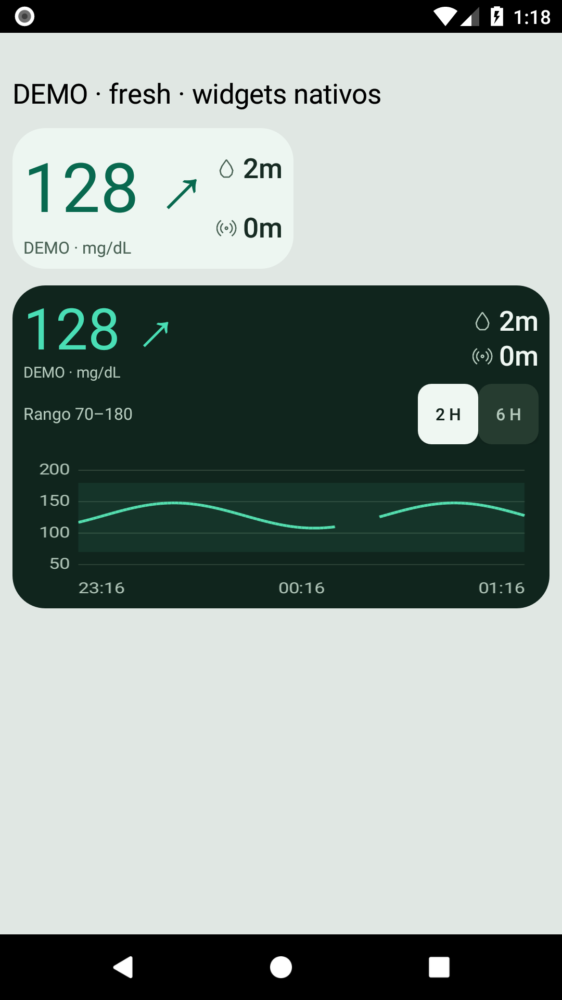
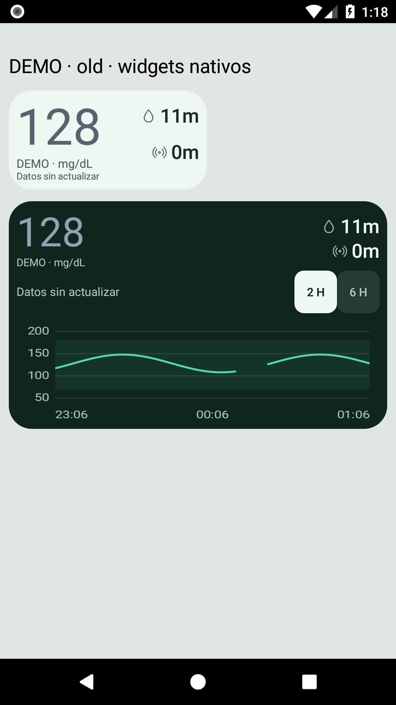
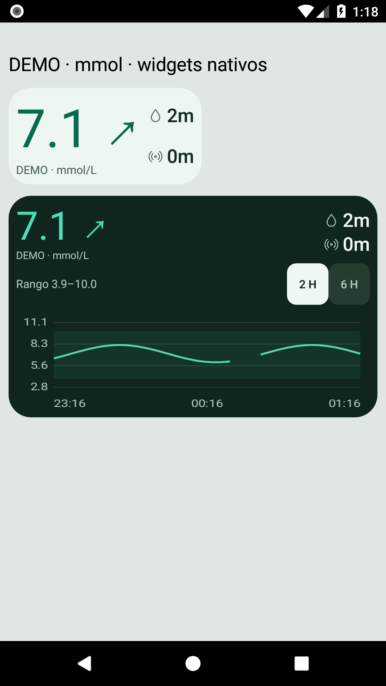
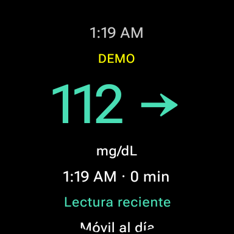

# GlucoTick para Android y Wear OS

Beta pública para consultar lecturas compartidas mediante LibreLinkUp en el móvil, widgets y reloj Wear OS. Incluye cinco esferas: Original, Dashboard, Iconos, Horizonte y Dúo Radial. El móvil consulta la cuenta; el reloj recibe los datos y proporciona complicaciones.

**Entrega 0.1.14-beta.1 — beta de prueba.** [Descargar APK y ZIP](https://github.com/tiri14/glucotick-android-releases/releases/tag/android-v0.1.14-beta.1).

| Componente | Requisito mínimo |
|---|---|
| Móvil | Android8/API26 |
| App Wear y cinco esferas | Wear OS4/API33 y móvil Android compatible |

La documentación de esta entrega distingue pruebas de emulador y observaciones físicas previas. No implica certificación de todos los relojes o fabricantes. Consulta [VALIDACION.md](VALIDACION.md).

Mantén actualizados el sistema y los servicios del reloj. En el emulador Wear API33 fue necesario actualizar su renderizador oficial para activar Dúo Radial; la combinación concreta se detalla en la validación.

## Instalación

Lee [INSTALACION.md](INSTALACION.md) antes de instalar. El APK móvil se instala en el teléfono. Wear y esferas se instalan por separado en el reloj; el ZIP incluye un asistente PowerShell para PC con ADB oficial. No se instalan automáticamente en el reloj al abrir el APK móvil.

Esta beta usa una firma permanente nueva. Las instalaciones privadas anteriores usan otra firma y no pueden actualizarse directamente con este paquete. El instalador se detiene ante esa situación y conserva sus datos. No desinstales tu versión privada sin un plan de migración.

## Aspecto con datos DEMO

Capturas nativas de emuladores, generadas con lecturas ficticias. Los widgets se muestran en una vista de comprobación; el tamaño y la colocación en Inicio dependen del launcher.

 

 

Después de una actualización compatible, abre GlucoTick y pulsa **Iniciar seguimiento**. La beta no garantiza reanudación automática tras actualizar o reiniciar. El indicador junto a la hora y su posición dependen del sistema del fabricante.

## Lecturas y privacidad

La edad corresponde a la medición original. Las lecturas antiguas pasan a gris, se tachan desde15min y se ocultan desde60min. La frescura de la fuente y el enlace del reloj se muestran separadamente. Configura la privacidad de bloqueo y los avisos en la app.

GlucoTick es independiente de Abbott y un visor complementario: no calcula dosis ni sustituye al dispositivo principal, sus alarmas o la atención sanitaria. Necesita una cuenta autorizada de LibreLinkUp con las lecturas compartidas disponibles. No ofrece conexión directa universal al sensor.

[Privacidad](PRIVACIDAD.md) · [Avisos de terceros](TERCEROS.md) · [Problemas de esta beta](https://github.com/tiri14/glucotick-android-releases/issues) · [GlucoTick para Windows](https://github.com/tiri14/glucotick-releases).

Al comunicar un fallo, indica versión, modelo y pasos, usando datos DEMO. No adjuntes contraseñas, tokens, cuentas, lecturas personales o capturas clínicas. Los fuentes y las pruebas se mantienen privados. Distribución gratuita de esta beta para evaluación; no se concede una licencia de código abierto sobre el código privado.
